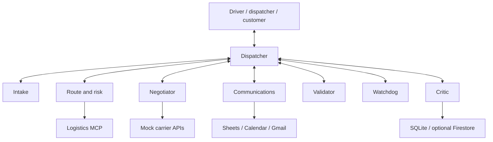

# Ghost Dispatcher — Implementation Plan

> When a vaccine truck breaks down at 2 AM, Ghost Dispatcher coordinates a rescue before a human dispatcher wakes up — and recovers when its own tools fail.

A self-healing, multi-agent control room for **cold-chain logistics**, built with **Google ADK, Python, and Gemini only**. This replaces the earlier TypeScript/eve proposal and retains specialist conversation ownership and handovers.

**Status: planning only.** No application or live integration is implemented yet. The first version uses synthetic cargo and simulated commercial actions; real medical disposition, carrier purchases, and production fleet operation are outside the submission.

## 1. Agent Wars context

These event details were supplied by the team; confirm eligibility, deadlines, and submission-update rules with organizers.

- Problem: **Logistics Handler**. Required tools: **Google ADK + Google products**.
- Criteria: A–Z instructions, multiple models/multimodal input, conversational agents, API calls, MCP integration, feedback, and self-healing.
- Submission: public GitHub repository, detailed end-to-end README, and submission form. The brief says first come, first served; submit a working core early.
- Team: minimum 2, maximum 4.
- [Registration](https://forms.gle/z8TdF1V4yq3mfESN8) · [Submission](https://forms.gle/dZZ1BLH8vDAKr5wJ9) · [Repository](https://github.com/HideshBalaji/gdg-agentwars).

## 2. Problem and reusable incident loop

When deliveries fail, dispatchers must find replacement vehicles, coordinate carriers, rebook dock slots, and update customers. Cold-chain cargo adds temperature and time constraints.

**detect → understand → re-plan → validate → act → notify → learn**

The same agents handle different incidents. Multimodal evidence becomes a typed incident; agents suggest plans, deterministic checks gate actions, and measured outcomes improve the next decision.

## 3. Scope

| Priority | Incident / input | Response |
| --- | --- | --- |
| Core: build deeply | Truck breakdown; driver photo + voice note | Identify cargo/location, estimate demo rescue window, find a suitable reefer, book through mock carrier, reassign cargo, rebook dock, notify demo recipients |
| Extra | Fridge failing; temperature feed | Estimate demo window and select a cold hub or transfer vehicle |
| Extra | Customer unavailable; chat | Negotiate a new delivery window and update the route/plan |
| Extra | Damaged delivery; photo | Record visible evidence, draft claim, initiate simulated replacement |

Build the breakdown flow completely before extras. Distinguish observed damage from uncertain image interpretation.

**Pitch-only stretch:** traffic/road closures/floods, standalone missed dock slots, driver-hours relief, carrier no-show, and checkpoint document assistance. Dock rebooking within the core breakdown flow remains required. Document assistance does not certify legal correctness.

## 4. Architecture and Gemini roles



| Agent | Model role | Responsibilities |
| --- | --- | --- |
| dispatcher | Gemini Pro | Receive incidents, coordinate specialists, choose validated plans, apply learned preferences |
| intake | Gemini Flash | Photo, voice note, PDF, sensor data → structured incident with evidence and missing-field clarification |
| route_risk | Gemini Flash | Maps/weather calls; code-based timeline calculation; cost/risk/time ranking |
| negotiator | Gemini Flash chat; optional Gemini Live | Carrier/customer conversation, simulated booking, rescheduling |
| comms | Gemini Flash | Dedicated Gmail notifications, Calendar dock slots, Sheets fleet board |
| validator | Plain code + Gemini Flash | Refrigeration, capacity, availability, deadline, and supplied driver-hours checks |
| watchdog | Plain code + Gemini Flash | Tool failure handling and visible Healing Log |
| critic | Gemini Flash | Ratings and outcomes → constrained learned preferences |

Use configurable `GEMINI_PRO_MODEL`, `GEMINI_FLASH_MODEL`, and optional `GEMINI_LIVE_MODEL`. Select compatible available IDs from the [official model catalog](https://ai.google.dev/gemini-api/docs/models) during implementation, pin tested defaults and SDK versions, and document them. “Pro”/“Flash” are role descriptions, not literal API IDs. Do not assume every model or Google API is free-tier eligible.

## 5. Specialist conversation ownership

- Dispatcher starts the conversation, then transfers ownership to the relevant specialist.
- The specialist speaks directly, asks follow-ups, and receives subsequent user messages; dispatcher does not rewrite every answer.
- Specialists can transfer to peers or back to dispatcher. Honor explicit user requests to switch agents.
- Preserve the objective, incident ID, evidence references, actions taken, decisions, and open questions across handovers.
- Persist session state and active ownership; announce who now owns the conversation and why.
- Use ADK's conversation transfer mechanism with parent/peer transfers enabled where appropriate. Background workflow calls and conversation ownership are distinct. See [ADK transfer guidance](https://github.com/google/adk-docs/blob/main/docs/agents/custom-agents.md).
- Limit automatic transfers to four per user turn; ask for clarification when routing loops.

Example: Dispatcher → Intake clarifies location → Route/Risk discusses options → Negotiator agrees the receiving window → Dispatcher resumes coordination. Internal validation/recovery need not take over an unrelated user conversation.

## 6. Core flow and execution rules

1. Parse evidence into a typed incident; retain timestamps/provenance and ask for missing identity, location, or shipment requirements.
2. Read current shipments, vehicles, hubs, carriers, and dock capacity through MCP.
3. Calculate candidate timelines, including replacement travel, transfer/loading, onward travel, and receiving availability.
4. Plan and validate for at most three iterations. If none is feasible, report the blockage and request human intervention.
5. Recheck availability, execute the simulated carrier booking, and assign the load.
6. Persist receipts; update the dedicated Google Sheet, Calendar, and Gmail demo recipients.
7. Record outcomes and collect feedback.

Enforce stock/capacity/reservation changes transactionally. Use idempotency keys and durable action receipts. Reconcile a timed-out booking before trying another carrier: the first booking may have succeeded. External steps need compensating cancellation where supported. Never report the rescue complete while a required booking remains pending.

## 7. Self-healing at five levels

Every attempt enters the visible **Healing Log** with incident/action ID, tool/provider, time, failure category, remedy, and result; exclude credentials.

| Level | Behavior |
| --- | --- |
| Retry | Bounded backoff/timeouts for transient errors and eligible rate limits; respect retry guidance |
| Provider fallback | Primary carrier → backup carrier → Gmail booking request; reconcile ambiguous prior outcomes first |
| Validation loop | Code violations return to planning through `LoopAgent`, maximum three iterations |
| Tool-call repair | One corrected attempt for schema mistakes using known facts; revalidate and never invent identifiers or bypass business/auth constraints |
| Learned workaround | Persist provider failure and successful alternative with expiry; temporarily skip unhealthy providers and probe recovery later |

**A Gmail request is pending confirmation, not a confirmed booking.** Failed or uncertain notification sends must be reconciled rather than blindly duplicated.

Use `before_tool_callback` for checks, `after_tool_callback` for successful results, and `on_tool_error_callback` or tool wrappers for raised errors. The success callback alone does not catch exceptions. Confirm signatures against the pinned SDK. Sources: [callbacks](https://adk.dev/callbacks/types-of-callbacks/) and [LoopAgent](https://adk.dev/agents/workflow-agents/loop-agents/).

Mock carrier exposes demo-only `POST /kill` and `POST /revive`. Add a deterministic booking pause so the stage demo can fail the provider mid-booking and visibly recover through a backup.

## 8. Feedback loop

1. User rates an incident 👍/👎 with a reason, linked to its plan and outcome.
2. Critic proposes a typed preference: e.g. “if rescue slack exceeds 60 minutes, prefer the cheapest feasible carrier.” The threshold is a demo preference, not a medical rule.
3. Validate against an allowlist of ranking choices and store provenance plus outcome metrics.
4. Automatically activate valid ranking-only rules in demo mode. Unknown or constraint-changing feedback requires review and never changes hard checks.
5. Retrieve relevant preferences for each new incident and specialist handover; explain their effect.

Start with SQLite; Firestore is optional shared memory after the local loop works. This is retrieved guidance, not model fine-tuning or automatic code rewriting.

Demo two comparable incidents with two feasible carriers. After “too expensive,” the second chooses the cheaper valid option. Hold other conditions constant and restore the killed carrier so the decision change is attributable to feedback.

## 9. MCP and API contracts

Use FastMCP from the [official MCP Python SDK](https://github.com/modelcontextprotocol/python-sdk). ADK must actually discover and invoke `logistics-mcp` tools.

| Tool | Purpose |
| --- | --- |
| `get_shipment(shipment_id)` | Cargo, weight, temperature policy, destination, deadlines |
| `list_trucks_near(lat, lng, radius_km, needs_reefer)` | Available trucks with capacity |
| `assign_load(shipment_id, truck_id)` | Validated, replay-safe reassignment |
| `get_temperature_history(truck_id)` | Timestamped readings |
| `find_cold_hubs_near(lat, lng)` | Hubs with capacity and compatible storage |
| `book_dock_slot(warehouse_id, time)` | Reserve slot and return receipt |
| `list_carriers(region)` | Cost, reliability, capabilities, service health |
| `log_incident(incident)` | Persist incident, plan, actions, healing history, outcome |

Provide caller-scoped permissions and stable action metadata for writes. Share one validated service layer across MCP/API tools and return structured errors.

FastAPI mocks supply carrier quote/booking/status/cancellation endpoints, kill/revive controls, and sensor feeds. Wrap Maps Routes/Places, Google Weather, Sheets, Calendar, and Gmail as typed ADK tools. Keep fixture mode visibly separate; never label simulated responses as live data.

## 10. Data and demo rescue-window math

Seed **10 trucks, 20 shipments, 3 warehouses/cold hubs, 3 carriers**, one with fault injection. Include licensed/team-created synthetic photos, voice notes with transcripts, a delivery-slip PDF, and sensor traces.

| Entity | Fields |
| --- | --- |
| Truck | ID, reefer, capacity/available capacity, location, status, temperature, driver ID, supplied hours remaining |
| Shipment | ID, cargo, weight, temperature min/max, synthetic excursion allowance, origin, destination, deadline, value, priority, assigned truck |
| Hub / Warehouse | ID, location, free capacity, temperature capability, dock slots |
| Carrier | ID, name, configured API URL, region, cost/km, reliability, reefer availability, service health |
| Incident | ID, type, inputs, status, plan, actions, healing log, outcome, rating, conversation reference |
| Preference | ID, source incident, validated condition/ranking rule, status, creation time |

Fit a trend to recent timestamped readings, estimate time to the upper threshold, and combine it with the shipment's **synthetic excursion allowance**. Account for time already outside the range and apply the earlier delivery deadline. Handle insufficient, stale, flat, falling, and noisy readings explicitly; do not infer unlimited safety from a flat trend.

Label the output **demo rescue-window estimate**, not actual vaccine usability. Product-specific excursion decisions require the applicable handling protocol and qualified review; see [CDC storage/handling guidance](https://www.cdc.gov/vaccines/hcp/storage-handling/). Supplied driver hours are demo constraints, not a legal compliance determination.

## 11. Stack and layout

Python 3.12, Google ADK, Pydantic, SQLite, FastMCP, FastAPI, and Gemini via AI Studio. Use `adk web` for local demo chat/traces and API/terminal access for repeatable checks. Optional Gemini Live is browser voice, not real phone calls; uploaded voice-note intake remains core even if Live is cut.

Google products: Maps Routes/Places/Weather, Sheets, Calendar, Gmail; optional Firestore and Cloud Run. Cloud Run requires authentication and durable storage. Do not present a development UI as production hosting. Pin dependencies and retain a lockfile. Runtime models remain Gemini-only even if coding assistants use other providers.

```text
gdg-agentwars/
├── ghost_dispatcher/
│   ├── __init__.py
│   ├── agent.py          # ADK discovery: root_agent
│   ├── agents/           # eight specialist/coordinator modules
│   ├── models/           # shared typed contracts
│   ├── services/         # operations, booking, recovery
│   ├── tools/            # Google adapters
│   └── memory/           # preferences, provider health
├── mcp_server/
├── mock_services/        # carriers, sensor simulator
├── data/                 # synthetic fixtures/media only
├── tests/
├── evals/
├── scripts/              # seed.sh, demo.sh, smoke checks
├── docs/                 # architecture, demo script
├── .env.example
├── pyproject.toml
├── PLAN.md
└── README.md
```

Keep credentials, OAuth tokens, operational databases, and real customer/cargo data out of Git. Use dedicated Google demo resources and recipient allowlists. Sheets may use service-account sharing; Gmail needs user OAuth or explicitly provisioned Workspace delegation. AI Studio keys do not authorize Workspace APIs.

## 12. Judging mapping

| Criterion | Demonstrated evidence |
| --- | --- |
| Multiple models/multimodal | Pro + Flash; photo/voice/PDF/sensor intake; optional Live |
| Conversational agents | Specialist ownership, follow-ups, peer/dispatcher handovers, negotiation |
| API calls | Google services and mock-carrier receipts |
| MCP | Real tool discovery/call traces |
| Feedback | Rating → constrained rule → memory → changed next decision |
| Self-healing | Kill carrier mid-booking; visible recovery and valid completion |
| A–Z instructions | Clean-clone setup, one-command demo, diagrams, troubleshooting |

## 13. Team split and milestones

Target roughly two days with 3–4 people; estimates overlap across owners and are not a promised completion time.

| Person | Ownership | Deliverable |
| --- | --- | --- |
| A: agents lead | Dispatcher, intake, route/risk, negotiator chat, handovers, critic, memory | Complete incident orchestration and visible feedback-driven second decision |
| B: integrations lead | Shared models/services, seed data, MCP, Google adapters, comms agent | Stable tool contracts, data, and live Sheet/Calendar/Gmail demo resources |
| C: reliability lead | Validator, watchdog, recovery service, mock carriers/sensors, reliability tests | Kill/revive recovery, invalid-plan rejection, Healing Log, duplicate protection |
| D: demo/delivery lead | Scripts, documentation, CI, demo UI wiring, optional Live adapter, backup recording | One-command clean-clone demo and submission-ready README/video |

Separate branches: `feat/agents`, `feat/integrations`, `feat/recovery`, `feat/demo-docs`. B owns schema changes; A coordinates orchestration changes. C owns validator/watchdog modules; B owns comms; D agrees negotiator integration with A before editing it. Each person includes focused tests. Merge small PRs after the shared smoke scenario passes.

**First handoff:** agree `Incident`, `Plan`, `ToolResult`, `HealingEvent`, seed IDs, ports, and tool contracts. B publishes fixtures/contracts; A uses fixture tools; C builds mock carrier and validator; D prepares reproducible startup instructions. Integrate the photo-to-Sheet vertical slice before extras.

| Phase | Estimate | Work / exit condition | Owner |
| --- | --- | --- | --- |
| 0 | 2h | Registration, repo, keys, schemas, seed IDs, contracts | All |
| 1 | 8h | Photo + voice note → incident → valid plan → simulated assignment → live Sheet | A + B |
| 2 | 4h | Calendar rebooking and Gmail demo notification | B |
| 3 | 6h | Kill/revive recovery, validator loop, Healing Log | C |
| 4 | 4h | Rating changes next comparable decision | A |
| 5 | 3h | Up to three extra incidents using existing agents | B + C |
| 6 | 4h | Optional browser Live negotiation | D |
| 7 | 4h | Clean-clone rehearsal, README, diagram, backup video, team submission | All |

With three people, split D's documentation/scripts across B/C and let A handle optional voice. With two, one owns agents/feedback and the other owns data/integrations/recovery; share docs and cut optional voice/extras.

**Cut order:** Live voice → extras → comms polish. Never cut core loop, real MCP usage, healing, feedback, or README. Submit the working core early and confirm organizer rules for subsequent updates.

## 14. Three-minute demo

ADK chat/traces and Healing Log on the left; live fleet Sheet on the right.

| Time | Action |
| --- | --- |
| 0:00 | Simulated TN-07 breakdown near Hosur, vaccine demo cargo, configured four-hour rescue window |
| 0:20 | Photo + uploaded voice note → incident facts, evidence, location, constraints |
| 0:50 | Show reefer candidates, validation, selected plan, and specialist handover |
| 1:30 | Pause booking, hit `/kill`, resume; show fallback receipt, reassignment, dock update, notification, live Sheet change |
| 2:10 | Rate “too expensive,” revive primary carrier, run comparable incident, show cheaper feasible choice and learned reason |
| 2:40 | Show completed action/outcome evidence and close with Ghost Dispatcher pitch |

Optional 20-second browser voice negotiation. Keep a recorded backup video. Describe cargo/outcomes as simulated; do not claim real medical cargo was saved.

## 15. Verification

- Multimodal fixture parsing, evidence provenance, missing-data clarification.
- Specialist follow-ups, peer transfers, return to dispatcher, explicit switching, restart-safe ownership, loop limits.
- Non-reefer, overload, insufficient capacity, unavailable slot, stale plan, and deadline rejection; include transfer/loading time.
- Temperature simulation with stale/noisy/insufficient/already-out-of-range readings.
- MCP discovery/calls, typed API behavior, unauthorized-write rejection.
- Carrier failure before/after commit, ambiguous booking reconciliation, no duplicate assignment/reservation.
- Bounded retries, one argument-repair attempt, provider-health expiry and recovery probe.
- Pending email booking stays pending; partial workflows never report full success.
- Feedback changes ranking while hard constraints remain enforced.
- Live Sheets/Calendar/Gmail checks on dedicated resources; distinguish them from offline/fixture tests.
- Clean-clone rehearsal using only README and `.env.example`.

Run automated domain/integration checks and ADK evaluations; record exact commands/results in the completed README. Documentation-only commits do not claim implementation tests have passed.

## 16. README and submission checklist

- [ ] Pitch/problem, supported incidents, demo limitations, team members.
- [ ] Architecture diagram, agent/model roles, conversation handovers.
- [ ] Python/install prerequisites, pinned dependencies, tested model IDs.
- [ ] Google project/API enablement, keys/OAuth/scopes, dedicated demo resources.
- [ ] `.env.example` line by line: models, endpoints, Sheet/Calendar IDs, recipients, storage.
- [ ] Install/seed/start/stop/reset and one-command `scripts/demo.sh`.
- [ ] Incident triggers, sample media, MCP tools, API examples, trace inspection.
- [ ] `/kill` and `/revive`, expected Healing Log, feedback/rating demo.
- [ ] Test/evaluation commands, results, troubleshooting, quotas, known limitations.
- [ ] Judging mapping, demo script, backup video, submission instructions.

## 17. Risks and open team questions

| Risk | Mitigation |
| --- | --- |
| Live voice flaky | Build last; chat + uploaded voice notes remain functional |
| Google auth/quota issues | Verify early; dedicated account, labeled fixtures, recorded backup |
| Scope creep | One deep incident before extras |
| Invalid generated plan | Code validation before actions |
| Stale learned workaround | Expiry and provider recovery probes |
| Late submission | Early working core; confirm update rules |
| Misleading temperature certainty | Clearly labeled simulation, no medical-use decisions |

Confirm final team size/hours, dedicated demo account, submission deadline/update policy, and organizer interpretation of multi-model versus multimodal. This design covers both interpretations and uses Gemini-only runtime.

## References

- [Google ADK](https://google.github.io/adk-docs/) · [ADK Python](https://github.com/google/adk-python).
- [Gemini models](https://ai.google.dev/gemini-api/docs/models) · [Live API](https://ai.google.dev/gemini-api/docs/live).
- [MCP Python SDK](https://github.com/modelcontextprotocol/python-sdk).
- [Maps Routes](https://developers.google.com/maps/documentation/routes/compute_route_directions) · [Weather](https://developers.google.com/maps/documentation/weather/overview).
- [Sheets](https://developers.google.com/workspace/sheets/api/quickstart/python) · [Calendar](https://developers.google.com/workspace/calendar/api/quickstart/python) · [Gmail](https://developers.google.com/workspace/gmail/api/quickstart/python).
- [Firestore](https://cloud.google.com/firestore/docs).
