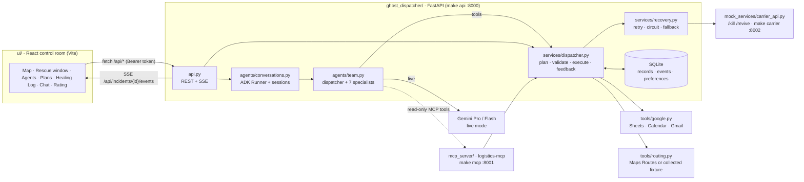
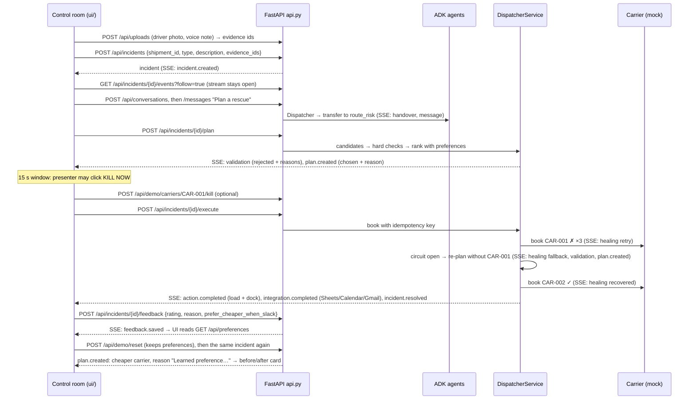

# Ghost Dispatcher

[](https://github.com/HideshBalaji/gdg-agentwars/actions/workflows/ci.yml)

> When a vaccine truck breaks down at 2 AM, Ghost Dispatcher coordinates a rescue before a human dispatcher wakes up, and recovers when its own tools fail.

GDG **Agent Wars** entry for the problem statement **"Logistics Handler"**. Built with **Google ADK, Python, Gemini, MCP, FastAPI and a React control room**.

Ghost Dispatcher is a self-healing, multi-agent system for **cold-chain logistics incidents**. Specialist agents take an incident from raw evidence (a driver's photo, a voice note, a temperature feed) to a validated rescue: a replacement reefer truck, a carrier booking, a rebooked dock slot and notified stakeholders. When a carrier API fails mid-booking, it retries, falls back and finishes anyway. A human rating becomes a stored preference that changes the next decision.

All cargo, carrier bookings and Google actions in offline mode are **simulated and labelled as simulated**. Nothing here is a medical or legal determination.

---

## Contents

1. [Run it in 5 commands (no API keys)](#1-run-it-in-5-commands-no-api-keys)
2. [Run the full app: backend + control room](#2-run-the-full-app-backend--control-room)
3. [How it works end to end](#3-how-it-works-end-to-end)
4. [Agents, self-healing, feedback, MCP](#4-agents-self-healing-feedback-mcp)
5. [HTTP API and event stream](#5-http-api-and-event-stream)
6. [Configuration](#6-configuration)
7. [Live mode with Gemini and Google APIs](#7-live-mode-with-gemini-and-google-apis)
8. [Tests, CI and Docker](#8-tests-ci-and-docker)
9. [Troubleshooting](#9-troubleshooting)
10. [Judging criteria → evidence](#10-judging-criteria--evidence)
11. [Repository layout, status and limitations](#11-repository-layout-status-and-limitations)

---

## 1. Run it in 5 commands (no API keys)

**Prerequisites:** Python **3.12+** (CI uses 3.12; also verified on 3.14), Node.js **18+** with npm (CI uses 20), `make`, `git`. No API keys, no Google account, no network calls at runtime.

```bash
git clone https://github.com/HideshBalaji/gdg-agentwars.git
cd gdg-agentwars
make setup      # creates .venv and installs the Python package + dev tools
make ui-setup   # installs the control room's npm dependencies (npm ci)
make verify     # lint + 42 tests + offline agent demo + UI typecheck/build
```

`make verify` must exit 0. It runs:

| Step | Command | What it proves |
|---|---|---|
| Lint | `make lint` | `ruff` passes on all Python sources |
| Tests | `make test` | `pytest`: domain rules, API, real local MCP transport, ADK handovers, carrier fallback, feedback, persistence |
| Offline demo | `make demo` | A real ADK conversation (deterministic model double) hands over to Route & Risk, the primary carrier is killed, the rescue finishes through a backup, then feedback lowers the cost of a comparable incident |
| UI build | `make ui-build` | TypeScript typecheck + production build of the control room into `ui/dist` |

Expected tail of `make demo`:

```text
[SIMULATED] Conversation owner: route_risk
[SIMULATED] Primary killed; rescue resolved via CAR-002
{
  "simulated": true,
  "baseline_cost": 18500.0,
  "learned_cost": 12000.0,
  "currency": "INR",
  "reason": "Learned preference: cheapest feasible carrier within the approved cost/time policy",
  "healing_events": 5
}
```

---

## 2. Run the full app: backend + control room

Two terminals from the repository root.

```bash
# Terminal 1: FastAPI backend on http://127.0.0.1:8000 (OpenAPI at /docs)
make api
```

```bash
# Terminal 2: control room on http://localhost:5173
make ui
```

Open **http://localhost:5173**. The dev server proxies `/api` and `/health` to `127.0.0.1:8000`, so there is no CORS setup. Optional extra processes: `make mcp` (authenticated MCP server on :8001) and `make carrier` (mock carrier HTTP API on :8002 with `/kill` and `/revive`). Offline mode needs neither.

The control room has two modes, switched with the **DEMO ⇄ / LIVE ⇄ badge** in the top bar.

### Live mode (real backend)

1. Click the **DEMO ⇄** badge. It turns into **LIVE · backend online** and the map loads the backend's 10 trucks around Hosur. The carrier buttons now show the backend's carriers (`Polar`, `Budget`, `Contingency`; hover for the full name).
2. **Multimodal evidence:** click **Samples** under the chat to add the data team's driver evidence (`data/photos/reefer_truck.jpg` and the voice note `data/audio/breakdown.wav` with its transcript). You can also attach your own files with 📎, record a voice note with 🎙, or drag files onto the chat (JPEG, PNG, WAV, MP3, M4A, WebM, PDF; 10 MiB max). Each file uploads straight away to `POST /api/uploads`; a green ✓ means the backend stored it.
3. Click **Truck breakdown** (or press `1`). The UI:
   - creates an incident for `SHP-001` with the uploaded `evidence_ids` (`POST /api/incidents`) and opens its event stream; the photo and voice note appear on the incident card and in the chat;
   - opens an ADK conversation and sends *"Plan a rescue"* (the Dispatcher hands over to Route & Risk);
   - asks the backend for a validated plan (`POST /plan`): rejected trucks are struck out with the validator's reason, and the chosen plan glows;
   - **pauses 15 seconds before booking** while the chosen carrier's button flashes **KILL NOW**.
4. **Self-healing:** click the flashing carrier button (or press `K`) within that window. The backend's carrier is killed (`POST /api/demo/carriers/CAR-001/kill`). The Healing Log shows the retries failing, then a fallback, then the booking via the backup carrier (`TN-03` via `CAR-002`). The map draws the rescue route.
5. The incident resolves: assignment, dock, Sheets/Calendar/Gmail receipts (simulated) and an outcome toast.
6. **Feedback:** in the rating box, keep the reason *"Too expensive…"* and click **Needs work**. The backend stores a ranking-only preference (`GET /api/preferences`). It appears in the memory list as **P-001**.
7. **Learning, visible:** click **Run comparable incident** (in the Critic's reply, or **Comparable incident** in the top bar). The UI calls `POST /api/demo/reset`, which re-seeds the fleet, carriers and assignments to the same 02:00 snapshot but **keeps learned preferences and past incidents**. It then replays the same breakdown with every carrier healthy and no kill. A **Decision changed by feedback** card shows the planner's first choice before the rating vs. now:

   | | Truck · carrier | Cost | Delivery |
   |---|---|---|---|
   | Before rating | TN-02 · CAR-001 | ₹18,500 | 07:35 |
   | After rating | TN-03 · CAR-002 | ₹12,000 | 08:50 |

   That's ₹6,500 saved for 75 minutes later, within both deadlines, with the reason *"Learned preference: cheapest feasible carrier within the approved cost/time policy"*. Because the fleet and carriers are identical, the change is attributable to the feedback alone.
8. **Chat:** type *"Why this vehicle?"* in the message box. The specialist that owns the conversation answers from the backend. Any pending evidence is sent with the message (`evidence_ids`).

> **Replay note:** `POST /api/demo/reset` (offline mode only) makes runs repeatable without restarting. To also clear learned preferences and history, restart with a fresh database: `GHOST_DATABASE=runs/demo-$(date +%s).sqlite make api`.

### Demo mode (scripted, no backend)

The default mode needs no backend. Press **Truck breakdown** (`1`) to play a richer scripted incident through the same UI: the driver's photo and a playable voice note, Intake facts, a Maps timeout retry, two validator rejections and a re-plan (attempt 2 of 3), the carrier booking with its **KILL NOW** window, the fallback, a dock-slot argument repair, and notifications. Rate it *"too expensive"*, click **Run comparable incident**, and the Dispatcher picks the cheaper carrier (KA-11 ColdLine ₹18,400 → KA-04 FrostFleet ₹11,200), citing the learned rule in the same **Decision changed by feedback** card. Files you attach in demo mode stay in the browser. The scripted engine emits the same typed events the backend stream is mapped onto (`ui/src/lib/contract.ts`).

**Keyboard:** `1` start breakdown · `K` kill/revive the first carrier · speed button `1×/2×` · **Reset** clears the incident.

---

## 3. How it works end to end

Every incident runs through the same loop:

**Detect → Understand → Re-plan → Validate → Act → Notify → Learn**

The stepper at the top of the control room shows which stage is running.

### Architecture



### One incident, step by step



### What each stage does

| Stage | Backend | Control room |
|---|---|---|
| **Detect** | `POST /api/incidents` persists the incident and emits `incident.created` | Incident card, red pulse on the broken truck, rescue-window countdown from the shipment's cold-restore deadline |
| **Understand** | The ADK Dispatcher reads the incident and transfers to a specialist. In live mode Intake reads uploaded photos/audio/PDFs with Gemini; offline mode never invents evidence | Agent constellation lights the owner; handover line in the chat |
| **Re-plan** | Route & Risk computes candidates from fleet, hubs, sensors and routes (collected fixture offline, Maps Routes live) | Plan cards with time, cost, slack |
| **Validate** | Deterministic code rejects plans that fail reefer, capacity, availability, rescue-window or driver-hour checks (`services/validation.py`). Agent planning is wrapped in a `LoopAgent` (max 3 iterations) | Rejected cards are struck out with the reason. The chosen card glows with the ranking reason |
| **Act** | Books the carrier with an idempotency key, then reassigns the load and dock atomically. Failures go through `services/recovery.py` | Healing Log rows (retry → fallback → recovered), booking and assignment receipts, rescue route on the map |
| **Notify** | Sheets fleet board, Calendar dock event, Gmail notification (`tools/google.py`, simulated offline). Failed syncs become retryable jobs | Receipts for each integration; *pending* if a sync is pending |
| **Learn** | Feedback becomes a typed, scoped, expiring ranking preference. Hard checks never change. `POST /api/demo/reset` restores the fleet but keeps preferences, so a comparable incident can be replayed | Rating box → stored rule in memory → **Run comparable incident** → *Decision changed by feedback* card (before vs. after) |

---

## 4. Agents, self-healing, feedback, MCP

### Agents (`ghost_dispatcher/agents/team.py`)

| Agent | Gemini role (live) | Responsibility |
|---|---|---|
| dispatcher | Pro | Owns the incident, delegates to specialists, picks the validated plan, applies learned preferences |
| intake | Flash | Multimodal parsing of photos, voice notes, PDFs and sensor data into a structured incident |
| route_risk | Flash | Routing and rescue-window calculation, candidate ranking |
| negotiator | Flash | Carrier booking and customer conversations |
| comms | Flash | Sheets fleet board, Calendar dock slots, Gmail notifications |
| validator | Code + Flash | Hard constraint checks before any action |
| watchdog | Code + Flash | Tool-failure detection, recovery and the Healing Log |
| critic | Flash | Turns ratings and outcomes into constrained preferences |

Specialists own the conversation while they work and hand over to peers or back to the dispatcher through ADK agent transfer (max 4 transfers per message). Send `target_agent` in a chat message to ask for a specific specialist. `ghost_dispatcher/agent.py` exposes `root_agent`, so `adk web` from the repository root also works for trace inspection.

### Self-healing

| Level | Behavior | Where you see it |
|---|---|---|
| Retry | Bounded backoff for connection/unavailability errors (up to 3 attempts) | Healing Log `RETRY` rows |
| Provider fallback | Circuit opens for the failed carrier (60 s); re-plan through the next feasible carrier; ambiguous outcomes are reconciled by booking ID, never double-booked | `FALLBACK` row → `recovered`, plan card for the failed carrier struck out |
| Validation loop | Rejected plans go back to planning (`LoopAgent`, ≤ 3 iterations); code checks every plan regardless of which agent proposed it | Struck-out plan cards with reasons |
| Tool-call repair | One corrected attempt per tool/message after a schema error, never inventing identifiers | Healing Log `REPAIR` row (demo mode) |
| Learned workaround | Provider health and circuit state persist, so unhealthy carriers are skipped until revived/probed | Carrier buttons show **DOWN**; system LEDs turn red |

Kill and revive carriers from the UI buttons, from `POST /api/demo/carriers/{CAR-00x}/kill|revive`, or from the standalone mock (`make carrier`, then `POST :8002/kill`).

### Feedback loop

1. Rate the incident 👍/👎 with a reason (`POST /api/incidents/{id}/feedback`).
2. With `prefer_cheaper_when_slack: true` (the UI sets it when the reason mentions cost), the backend activates the collected pack's policy: *save at least INR 5,000 for at most 90 minutes of later delivery, within both deadlines*, scoped to customer, cargo profile and currency, with an expiry.
3. The next comparable incident's ranking applies it after every hard check passes. `make demo` proves it: TN-02 / CAR-001 (INR 18,500) → TN-03 / CAR-002 (INR 12,000).
4. Free-text feedback is stored, never executed as instructions.

### MCP: `logistics-mcp` (`mcp_server/server.py`, `make mcp`)

Built with the official MCP Python SDK (FastMCP), served over streamable HTTP at `http://127.0.0.1:8001/mcp`. It requires `Authorization: Bearer ghost-demo` offline.

| Tool | Purpose |
|---|---|
| `get_shipment` | Cargo, weight, temperature policy, destination, deadlines |
| `list_trucks_near` | Available trucks with capacity and refrigeration |
| `assign_load` | Validated, replay-safe reassignment (forwards to the API worker) |
| `get_temperature_history` | Timestamped reefer readings |
| `find_cold_hubs_near` | Hubs with free, compatible cold storage |
| `book_dock_slot` | Dock receipt reserved atomically with load assignment |
| `list_carriers` | Cost, reliability, capabilities, service health |
| `log_incident` | Incident, plan, actions, healing history and outcome |

---

## 5. HTTP API and event stream

All `/api/*` routes need `Authorization: Bearer ghost-demo` offline. Only `/health` is public. Full contract: [docs/BACKEND.md](docs/BACKEND.md#ui-contract) and `http://127.0.0.1:8000/docs`.

| Method and path | Purpose |
|---|---|
| `GET /health` | `{"status":"ok","mode":"offline"}` |
| `GET /api/fleet` | Trucks, shipments, carriers, warehouses, dataset and decision clock |
| `POST /api/uploads` | Multipart evidence (JPEG/PNG/WAV/MP3/M4A/WebM/PDF, ≤ 10 MiB) |
| `POST /api/incidents` | `{shipment_id, type, description, evidence_ids}` → incident |
| `POST /api/incidents/{id}/plan` | Validated candidates + chosen plan (no booking) |
| `POST /api/incidents/{id}/execute` | Book, assign, reserve dock, sync Google; repeat-safe |
| `POST /api/conversations` · `POST /api/conversations/{id}/messages` | ADK conversation with specialist ownership |
| `GET /api/incidents/{id}/events?after=0&follow=true` | Server-sent events with durable IDs (replay with `after` or `Last-Event-ID`) |
| `POST /api/incidents/{id}/feedback` · `GET /api/preferences` | Ratings and learned ranking preferences |
| `POST /api/demo/carriers/{id}/kill` · `/revive` | Simulated carrier fault controls |
| `POST /api/demo/reset` | Offline only: re-seed fleet, carriers and assignments; keep preferences, feedback, incidents and evidence |

Try it with curl while `make api` runs:

```bash
curl -s http://127.0.0.1:8000/health
curl -s -H 'Authorization: Bearer ghost-demo' -H 'Content-Type: application/json' \
  -d '{"shipment_id":"SHP-001","type":"truck_breakdown","description":"TN-07 breakdown near Hosur","evidence_ids":[]}' \
  http://127.0.0.1:8000/api/incidents
```

### How the control room renders backend events (`ui/src/lib/live.ts`)

| SSE `type` | UI effect |
|---|---|
| `incident.created` | (UI opens the incident from the `POST` response) |
| `handover` | Agent constellation moves ownership; handover line in chat |
| `message` | Agent chat bubble (plan JSON is summarised into a sentence) |
| `validation` | Rejected plan cards with reasons; rescue deadline; feasible count |
| `plan.created` | Candidate cards, chosen plan and reason, rescue route preview |
| `healing` | Healing Log rows: retry attempts, fallback, recovered; red flash and toast on failure |
| `action.completed` | Load assignment + dock receipt; rescue truck drives on the map |
| `integration.completed` / `integration.pending` | Sheets, Calendar, Gmail receipts (confirmed or pending) |
| `incident.resolved` | Outcome toast, stage → Learn, rating box |
| `feedback.saved` | Reads `/api/preferences` and shows the stored rule |

The UI's own typed contract (`GhostEvent` in `ui/src/lib/contract.ts`) is what both the live adapter and the scripted demo engine emit, so every panel works in both modes.

---

## 6. Configuration

Backend settings come from environment variables (copy `.env.example` to `.env` to change them). Offline runs need none of them.

| Variable | Default | Purpose |
|---|---|---|
| `GHOST_MODE` | `offline` | `offline` (deterministic, no external calls) or `live` (Gemini through ADK) |
| `GHOST_API_TOKEN` | `ghost-demo` | Bearer token for `/api/*` and MCP. Live mode requires a private value of ≥ 24 chars |
| `GHOST_DATABASE` | `runs/ghost.sqlite` | SQLite file; use a fresh path to replay demos |
| `GHOST_DATASET` / `GHOST_DATA_DIR` / `GHOST_SEED_FILE` | `collected` / `data` / empty | Team-collected pack (10 trucks, 20 shipments, 3 carriers, 3 hubs), the `builtin` developer fixture, or a custom normalized seed |
| `GHOST_UI_ORIGIN` | `http://localhost:3000` | CORS origin if the UI calls the API directly instead of through the Vite proxy |
| `GHOST_API_URL` / `GHOST_MCP_URL` / `GHOST_CARRIER_URL` | `:8000` / `:8001/mcp` / `:8002` | Local service addresses |
| `GOOGLE_API_KEY`, `GOOGLE_GENAI_USE_VERTEXAI` | empty, `FALSE` | Gemini via AI Studio (live only) |
| `GEMINI_PRO_MODEL`, `GEMINI_FLASH_MODEL`, `GEMINI_LIVE_MODEL` | empty | Model IDs per agent role (live only) |
| `GOOGLE_MAPS_API_KEY` | empty | Routes API (live only) |
| `GOOGLE_OAUTH_TOKEN_FILE`, `GOOGLE_SHEET_ID`, `GOOGLE_CALENDAR_ID`, `GOOGLE_DEMO_RECIPIENT` | empty | Dedicated Google Workspace demo resources (live only) |

Control room settings (`ui/.env.example`, copy to `ui/.env.local`):

| Variable | Default | Purpose |
|---|---|---|
| `VITE_DEFAULT_MODE` | `demo` | Start in `demo` or `live` |
| `VITE_API_TOKEN` | `ghost-demo` | Must match `GHOST_API_TOKEN` |
| `VITE_API_URL` | empty | Empty = use the Vite proxy; set `GHOST_API=http://host:port` when starting `make ui` to proxy elsewhere |

---

## 7. Live mode with Gemini and Google APIs

Offline mode is the evaluated path. Live mode uses real Gemini models and Google APIs and needs credentials:

1. Set `GHOST_MODE=live`, `GOOGLE_API_KEY` ([AI Studio](https://aistudio.google.com/apikey)), `GEMINI_PRO_MODEL` and `GEMINI_FLASH_MODEL` ([model catalog](https://ai.google.dev/gemini-api/docs/models)).
2. Set a private `GHOST_API_TOKEN` (≥ 24 chars) and the same value as `VITE_API_TOKEN` for the UI.
3. Enable the Routes API and set `GOOGLE_MAPS_API_KEY`.
4. Enable the Sheets, Calendar and Gmail APIs, create the dedicated Sheet (tabs **Incidents** and **Fleet**) and Calendar, and generate a user OAuth token file stored outside the repo (`GOOGLE_OAUTH_TOKEN_FILE`).
5. Start `make carrier`, `make mcp`, then `make api`, then `make ui`.

The step-by-step guide, OAuth scopes and reconciliation rules are in [docs/BACKEND.md](docs/BACKEND.md#live-gemini-and-google-setup). Offline tests do not claim that Gemini or Google ran.

---

## 8. Tests, CI and Docker

```bash
make test        # pytest, offline
make lint        # ruff
make demo        # offline end-to-end agent demo (also scripts/demo.sh)
make ui-build    # UI typecheck + build
make verify      # all of the above
```

CI (`.github/workflows/ci.yml`) runs on every push to `main` and every pull request: Python lint, tests and the offline demo on 3.12; the UI typecheck and build on Node 20; and a container build that runs the tests.

```bash
docker compose build
docker compose run --rm app   # runs pytest inside the container
```

---

## 9. Troubleshooting

| Symptom | Fix |
|---|---|
| `cd: no such file or directory: ui` | Run commands from the repository root (`gdg-agentwars/`). `ui/` is inside it |
| UI badge shows **LIVE · backend error** | Start `make api` first, then click the badge again. Check `curl http://127.0.0.1:8000/health` |
| Chat or toast says *already rescued* / `sensor_data_missing` | That shipment was rescued in this database. Restart with `GHOST_DATABASE=runs/demo-$(date +%s).sqlite make api` |
| Kill had no effect | Click the carrier while it flashes **KILL NOW** (the 15 s window before booking). Killing after booking does nothing |
| **Samples** shows *Samples unavailable* | Start the UI with `make ui` (or `make ui-preview`); the dev server serves `/samples` from `data/` |
| Upload shows a red ✗ | Hover it for the reason: unsupported type, over 10 MiB, or the backend isn't running |
| 🎙 does nothing | Allow microphone access for `localhost:5173` in the browser |
| `401 unauthorized` | `VITE_API_TOKEN` (UI) must equal `GHOST_API_TOKEN` (backend) |
| Port 5173 or 8000 in use | Stop the other process; Vite will otherwise pick the next free port |
| `npm ci` fails | Use Node 18+ (`node -v`) |
| `make setup` fails | Use Python 3.12+ (`python3 --version`), or `uv sync --python 3.12 --extra dev --frozen` |

---

## 10. Judging criteria → evidence

| Criterion | Evidence | How to see it |
|---|---|---|
| Multi-model / multimodal agents | Gemini Pro + Flash roles; photo, voice, PDF and sensor intake; uploads endpoint | Live mode: **Samples**/📎/🎙 → `POST /api/uploads` → evidence on the incident and passed to Gemini Intake; agent cards show the model per role |
| Conversational agents | Specialist ownership, peer handovers, follow-ups, `target_agent` switching | Live mode: *"Plan a rescue"* → Route & Risk owns the chat; ask *"Why this vehicle?"* |
| API calls | FastAPI contract; carrier booking/status; Maps Routes, Sheets, Calendar, Gmail adapters | Plan/execute requests; receipts per integration; `make api` → `/docs` |
| MCP integration | `logistics-mcp` (official MCP SDK) with 8 tools, authenticated, used by ADK specialists | `make mcp`; `tests/test_mcp.py` drives the real transport |
| Feedback loop | Rating → scoped preference → changed ranking | Live UI: 👎 → **Run comparable incident** → *Decision changed by feedback* (₹18,500 → ₹12,000); `make demo`; `tests/test_api.py::test_demo_reset_replays_comparable_incident_with_learned_preference` |
| Self-healing | Carrier killed mid-booking → retries → circuit → fallback → recovered; validation loop; tool repair | Live mode **KILL NOW** → Healing Log; `make demo` prints `healing_events` |
| A–Z instructions | This README, [AGENTS.md](AGENTS.md), `make verify`, CI, Docker | Section 1 |

---

## 11. Repository layout, status and limitations

```text
ghost_dispatcher/        # ADK package and FastAPI backend
├── agent.py             # root_agent for `adk web`
├── api.py               # REST + SSE contract used by the UI (make api)
├── agents/              # team.py (8 agents), conversations.py (ADK runner/sessions), offline model double
├── models/contracts.py  # shared Pydantic contracts
├── services/            # dispatcher (plan/execute/feedback), validation, recovery, store, seeds
├── tools/               # carriers, routing, Google adapters (offline + live)
└── demo.py              # make demo
mcp_server/server.py     # logistics-mcp (make mcp)
mock_services/           # carrier API with /kill and /revive (make carrier)
ui/                      # React + Vite + Tailwind + Framer Motion control room (make ui)
├── src/lib/contract.ts  # typed GhostEvent contract rendered by every panel
├── src/lib/live.ts      # backend adapter: REST calls + SSE → GhostEvents
└── src/lib/demo/        # scripted demo engine and breakdown scenario
data/                    # collected synthetic fleet, scenarios, sensor traces, media, references
tests/                   # pytest suite
docs/                    # BACKEND.md (API/data/live setup), evidence.md
PLAN.md                  # design, team split, demo script
AGENTS.md                # exact commands for automated evaluators
```

| Area | State |
|---|---|
| ADK agents, handovers, validation loop, recovery, feedback, API, MCP, mock carrier | Implemented, tested offline, in CI |
| Collected dataset (10 trucks, 20 shipments, 3 carriers, 3 hubs) | Integrated with regression tests |
| Browser control room (demo + live mode against the backend) | Implemented; live mode verified end to end against `make api` (offline mode) |
| Gemini, Maps, Sheets, Calendar, Gmail live adapters | Implemented; credentialed rehearsal still needed |
| Gemini Live voice, weather, fridge-failing / customer / damaged-delivery UI flows | Planned |

**Known limitations**

- Offline mode stores uploaded photos and audio but does not interpret them; it never invents evidence. Multimodal interpretation runs only with Gemini in live mode.
- A shipment can be rescued once per database. Use **Run comparable incident** (`POST /api/demo/reset`, offline only) or a fresh `GHOST_DATABASE` to replay. Re-executing an incident from before a reset is not supported.
- The sample photo is an illustrative Wikimedia Commons image (CC BY-SA 4.0, credited in the UI and `data/photos/reefer_truck.json`); it does not depict TN-07.
- The backend is a single-operator demo: one API worker, SQLite, loopback binding.
- The map is a stylised SVG of the Bengaluru–Hosur corridor, not a tiled map; destinations far outside it (for example Chennai) are off-screen.
- All cargo, temperatures, driver hours and bookings are synthetic. No real carrier is ever booked.

Ownership, milestones and the 3-minute demo script are in [PLAN.md](PLAN.md). Real incidents behind the problem are in [docs/evidence.md](docs/evidence.md).

## For AI evaluators

Read [AGENTS.md](AGENTS.md). Short version: `make setup && make ui-setup && make verify` must exit 0 with no API keys.
